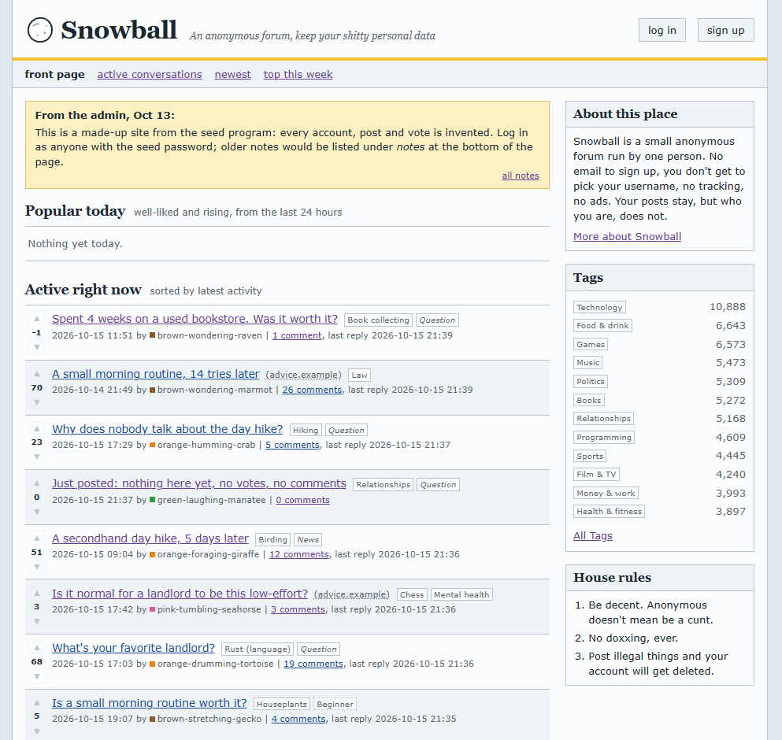
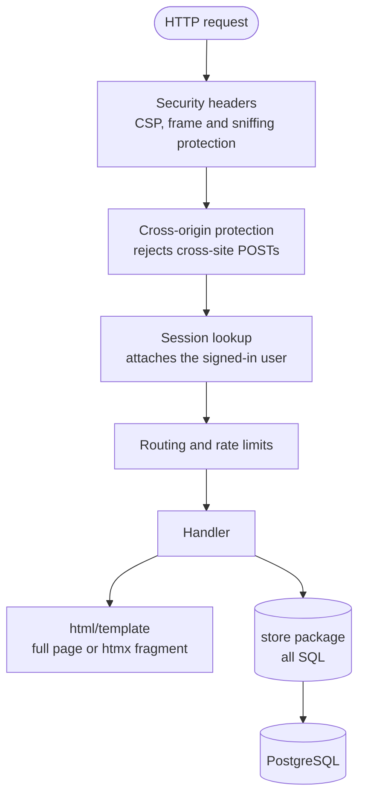
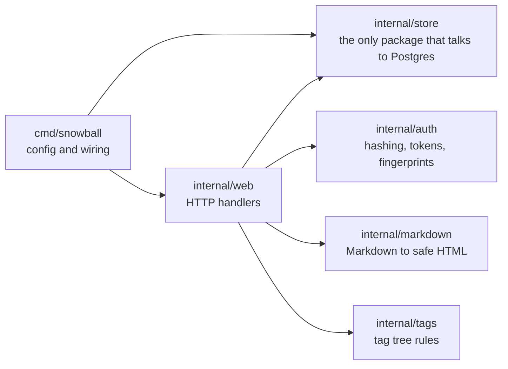
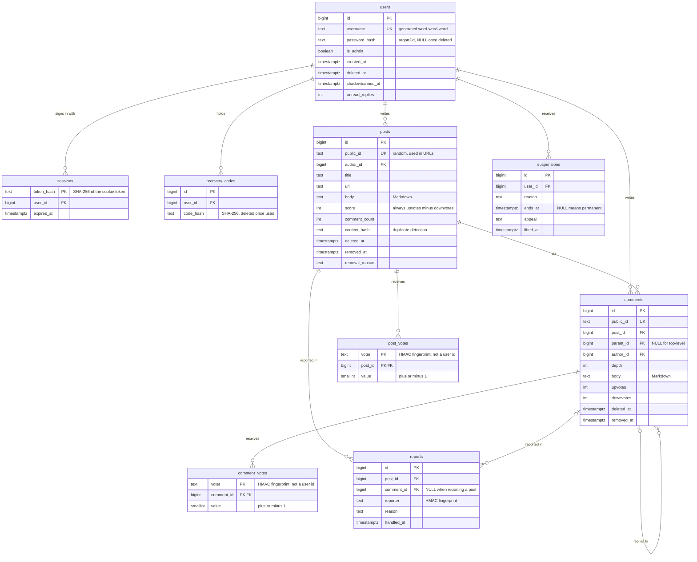
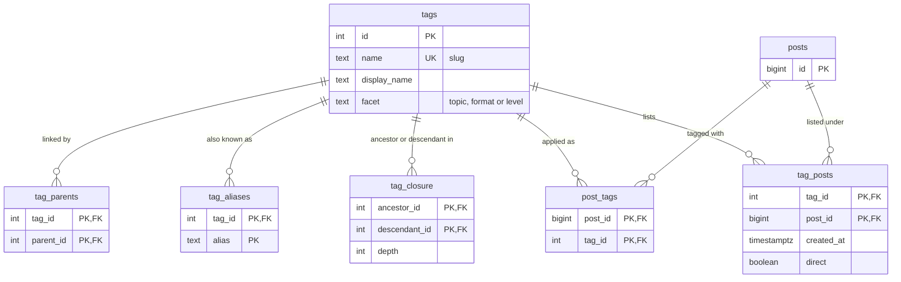
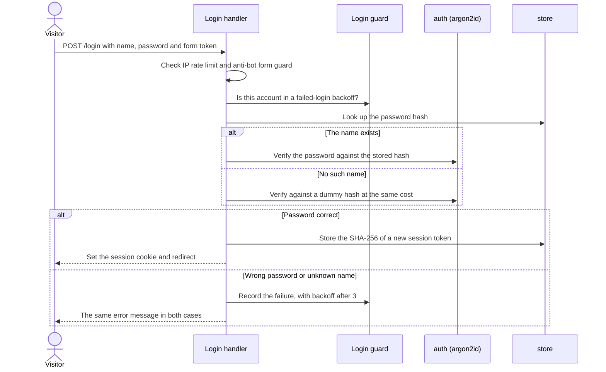
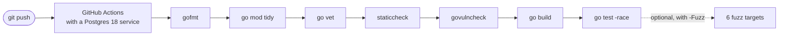

# Snowball

[](https://github.com/LawrenceMueller/Forum/actions/workflows/ci.yml)

An anonymous, privacy-first web forum built with Go, PostgreSQL and htmx.

No email, no real names, no tracking, no ads. Snowball picks your username, you pick the password, and the site stores as little about you as it possibly can.



**Contents:** [Features](#features) · [Tech stack](#tech-stack) · [Architecture](#architecture) · [Database](#database) · [Security and privacy](#security-and-privacy) · [Testing](#testing) · [How it was built](#how-it-was-built) · [Running it locally](#running-it-locally) · [Roadmap](#roadmap)

---

## Design principles

Four values drive nearly every decision in the codebase:

- **Anonymity.** Accounts are never tied to a real identity. There is no email field, and usernames are generated (`blue-humming-otter`), never chosen.
- **Store as little as possible.** No email addresses, IP addresses, user agents, login history or analytics. Anything not stored can never leak.
- **Manageable by one person.** One shared space organized by tags instead of many boards, and automated defenses instead of manual review wherever possible.
- **Hand-built character.** Dense, text-first pages with honest browser defaults that still feel modern, responsive and fast.

## Features

**Reading and posting**
- Link and text posts with sanitized Markdown, threaded comments, and up and down voting
- Front page with "popular today" and "active right now," plus new, active and top lists
- Keyset pagination that never skips or repeats posts, at any size
- Comment sorting by Wilson score ("best"), new or old, with collapsible threads and "continue this thread" for deep replies
- A 10-minute edit window enforced by the database clock, and self-deletion that erases content instead of hiding it
- Reply notifications, worked out from existing comments rather than stored separately

**Tags**
- A tree of 350 topics, formats and levels with aliases, so "sourdough" also shows up under Baking, Bread and Food & drink
- Type-ahead topic suggestions, ranked on the server so they always match what posting accepts
- An admin page for renaming, re-parenting, aliasing and merging tags, where every change is validated against the whole tree inside a transaction

**Accounts**
- Generated usernames, argon2id password hashing, and eight single-use recovery codes in place of email recovery
- A private history page of your own posts, comments, upvotes and downvotes
- Account deletion that unlinks your votes and can erase everything you posted

**Moderation**
- Reports with anonymous reporters, and automatic hiding when serious reports reach a threshold
- A review queue, removal reasons, timed suspensions with one appeal each, and a public moderation log that never shows content or names
- Shadowbans for obvious spam bots, account cleanup that withdraws votes, probation for new accounts, duplicate detection, and a domain blocklist
- Removed content is fully erased after 30 days

## Tech stack

| Layer | Choice |
|---|---|
| Language | Go, standard library `net/http` routing and `html/template` |
| Interactivity | htmx (self-hosted), plus a small amount of plain JavaScript |
| Database | PostgreSQL 18 through `pgx`, with goose migrations |
| Markdown | goldmark, sanitized with bluemonday |
| Password hashing | argon2id (`golang.org/x/crypto`) |
| Local infrastructure | Docker Compose |
| CI | GitHub Actions |

There is no web framework and no ORM. All SQL lives in one package.

## Architecture

Every request passes through the same middleware stack before it reaches a handler. Handlers return a full page, or just a fragment when htmx asks for one.



The code is split into packages whose dependencies only flow one way:



`auth`, `markdown` and `tags` never see a request or a database, which makes them easy to test in isolation. The `store` package never sees a raw secret: it only ever receives hashes and fingerprints.

## Database

The schema is built by 19 migrations in [`migrations/`](migrations). The core tables:



Note that the vote and report tables have no link to `users`. Votes are stored against a keyed fingerprint of the account, so a leaked database can't reveal who voted for what.

Tags form a tree that can have several parents per tag. A closure table stores every ancestor and descendant pair, so "everything under Food & drink" is one indexed lookup. `tag_posts` precomputes which posts show up under which tags, which took the largest tag page from 92 ms to 3 ms.



A few more tables support moderation: `mod_log` (the public moderation log, which records public IDs rather than foreign keys so it outlives what it describes), `blocked_domains` and `admin_notes`.

**Rules the database enforces itself**, so no bug in Go can break them:
- Usernames are unique forever, including deleted accounts.
- A live account always has a password, and a deleted one never does.
- A post's score always equals its upvotes minus its downvotes.
- One vote per account per post or comment, and one report per person per item.
- Deleted and erased content is actually empty, not just flagged.

## Security and privacy

**Passwords and sessions**
- Passwords are NFKC-normalized and hashed with argon2id. Stored hashes are parsed with strict bounds, so a damaged or planted hash can't crash the server or exhaust its memory.
- At most four hashes run at once, so a burst of logins can't exhaust the CPU.
- Session cookies use the `__Host-` prefix and are `HttpOnly`, `Secure` and `SameSite=Lax`. Only a SHA-256 hash of each session token is stored.
- Recovery codes are single-use. Each one is spent by a single atomic `DELETE ... RETURNING`, so it can never work twice, even under concurrent requests.

**Login without leaking which usernames exist.** A login for a name that doesn't exist still runs a full argon2id check against a dummy hash, so the response takes the same time either way, and both failures show the same message.



**Every request**
- A strict Content Security Policy (no inline scripts or styles, no third-party assets), plus `X-Frame-Options`, `nosniff`, `no-referrer` and a restrictive `Permissions-Policy`.
- Cross-site POSTs are rejected using Go's built-in cross-origin protection.
- Every form carries a honeypot field and a signed timing token, which catches bots that submit faster than a person could.
- Token-bucket rate limits per IP and per account on sign-ups, logins, posts, comments, votes and reports.
- All SQL uses placeholders, never string building with user input.
- Markdown is rendered with raw HTML off, then sanitized against an allowlist. Images are not allowed, since an external image would leak every reader's IP address to its host.
- Redirect targets are restricted to paths on Snowball. Fuzzing found a bypass using tab characters, which is now fixed and covered by a test.

**Privacy**
- Never stored: email, IP addresses, user agents, devices, locations, login times, or when a vote was cast.
- Votes and reports are stored under HMAC fingerprints, with the key kept outside the database.
- Rate limiting holds IP addresses only in memory, briefly, and never writes them anywhere.
- Log lines never contain passwords, tokens, cookies, IP addresses or votes.

## Testing

Every push runs the same script you run locally, so passing on your machine means passing in CI:



The suite has more than 160 tests:

| Kind | What it covers |
|---|---|
| Unit | Pure logic with no database: password rules, hashing, tokens, rate limiters, comment trees, Wilson scores, tag rules |
| Database | Every store function against a real Postgres, including the constraints the database enforces |
| Concurrency | Goroutines released together against one post, code or username, after which the data must still add up |
| Request-level | The full handler stack (headers, CSRF, sessions, rate limits, routes) driven through `httptest` |
| Smoke | Every page as every kind of visitor: status codes, security headers, complete HTML, htmx fragments |
| Fuzz | Go's fuzzer attacking hash parsing, password rules, redirects, pagination cursors, Markdown and the tag box |
| Migration round trip | Every migration up, all the way down and up again, with the schema checked for exact equality |

**Fuzzing found two real bugs:** an open redirect that slipped through using tab and newline characters, and stored-hash parameters that could make the server panic or exhaust its memory.

**Concurrency tests catch real races.** For example, removing the `FOR UPDATE` lock from the voting code makes rapid double-clicks fail with duplicate-key errors, and the test suite catches it.

**Performance** is measured against a seeded database of 20,000 accounts, 100,000 posts, 1.2 million comments and 5.8 million votes (`go run ./cmd/seed -size large`, then `go run ./cmd/bench`). Most pages render in under 10 ms. With 50 simultaneous visitors on two CPU cores, the server handles about 710 pages a second with a p99 of 141 ms and no failures.

## How it was built

Snowball was built entirely through [Claude Code](https://claude.com/claude-code) using spec-driven development. The code is AI-generated. My role was deciding what to build, setting the rules it had to follow, and verifying the result.

The center of that workflow is [`docs/PROJECT_CONTEXT.md`](docs/PROJECT_CONTEXT.md), a living spec that grew with the project. It covers the values, architecture, schema, invariants, every feature and where it lives, and a log of every product decision. Claude starts every session from it, so each change is made with the full context of the codebase. The test suite, CI checks and fuzzing are how I verify that what was generated actually holds up.

## Running it locally

You'll need [Go](https://go.dev/dl/) 1.27 or newer, Docker, and the [goose](https://github.com/pressly/goose) migration tool:

```sh
go install github.com/pressly/goose/v3/cmd/goose@latest
```

Then, from the project root:

```sh
cp .env.example .env      # development settings only
docker compose up -d      # start Postgres
goose up                  # apply the migrations
go run ./cmd/snowball     # start the site
```

Open http://localhost:8080.

| Task | Command |
|---|---|
| Run every check (what CI runs) | `pwsh ./scripts/check.ps1` |
| Quick check while working | `pwsh ./scripts/check.ps1 -Quick` |
| Tests only | `go test ./...` (add `-short` to skip database tests) |
| Fuzz every target | `pwsh ./scripts/check.ps1 -Fuzz` |
| Fill a dev database with a made-up site | `go run ./cmd/seed` (or `-size large`) |
| Time every kind of page | `go run ./cmd/bench` |

To make an account an admin, run `UPDATE users SET is_admin = true WHERE username = '...';` in `docker compose exec db psql -U snowball`.

## Project layout

```
cmd/snowball/      the server: configuration, wiring, graceful shutdown
cmd/seed/          generates a realistic test site
cmd/bench/         times every page and runs a load test
internal/auth/     passwords, tokens, recovery codes, fingerprints
internal/markdown/ Markdown to sanitized HTML
internal/tags/     the tag tree's rules
internal/store/    every SQL query
internal/web/      routes, middleware, handlers
migrations/        goose SQL migrations
templates/         html/template pages and htmx fragments
static/            CSS, htmx and a little JavaScript
docs/              the project spec
```

## Roadmap

- Image uploads, after researching the legal duties that come with hosting them
- Paging for very large comment threads
- Production deployment behind Caddy with automatic HTTPS
- Optional proof-of-work defenses (ALTCHA on sign-up, Anubis in front of the site) and an invite-only mode
